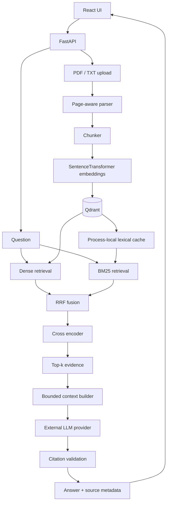

# DeepDocs AI

A production-style RAG document research assistant built from first principles without LangChain or LlamaIndex. Upload PDF/TXT documents, explore retrieved evidence, and ask questions with page-level citations through a React interface backed by FastAPI.

## Demo / Screenshots

Screenshots are pending; these are explicit placeholders, not captures of a deployed service.

| View | Screenshot placeholder |
| --- | --- |
| Upload | TODO: document ingestion summary |
| Answer with citations | TODO: grounded answer and highlighted source card |
| Retrieval explorer | TODO: ranked chunks with scores and page metadata |
| Benchmark comparison | TODO: measured development benchmark panel |

## Why this project

Long reports make finding the right passage difficult; generating fluent answers does not solve that problem. This project makes retrieval, source attribution, evaluation, and deployment tradeoffs visible so that answer quality can be investigated rather than assumed.

## Features

- PDF/TXT ingestion with page-aware character chunking and an optional token-aware mode.
- Local SentenceTransformer embeddings, Qdrant vector search, BM25 lexical retrieval, RRF fusion, and cross-encoder reranking.
- Grounded LLM answers with validated citation markers and page-level source metadata.
- React upload, session document selection, question answering, and retrieval explorer.
- Separate retrieval/generation evaluation, real-document benchmark, request IDs, structured logs, and deployment configuration.

## Architecture



The query diagram shows the quality-first strategy; the server also supports dense, BM25, and hybrid without reranking. See [architecture](docs/architecture.md) for lifecycle and storage boundaries.

## Retrieval Strategy

| Strategy | Practical role |
| --- | --- |
| Dense | Semantic similarity with the lowest measured median latency. |
| BM25 | Lexical matching for terms, numbers, and document vocabulary. |
| Hybrid | RRF merges dense and lexical rankings without mixing incompatible score scales. |
| Hybrid + rerank | A cross encoder reorders a bounded fused candidate set for better early evidence placement. |

`hybrid_rerank` is the quality-first portfolio recommendation on this benchmark. The configuration default remains `dense`; the frontend does not change the server strategy.

## Real Benchmark

**30-question assistant-reviewed development benchmark over 11,769 chunks from seven annual reports:** 26 answerable and four unanswerable questions. This is not an independent production benchmark or a claim of general model superiority.

| Strategy | Recall@5 | MRR@10 | NDCG@5 | P50 latency |
| --- | ---: | ---: | ---: | ---: |
| Dense | 0.3369 | 0.3901 | 0.2914 | 19.23 ms |
| BM25 | 0.6010 | 0.5969 | 0.5312 | 74.51 ms |
| Hybrid | 0.5891 | 0.6277 | 0.5159 | 93.58 ms |
| Hybrid + rerank | 0.7174 | 0.6936 | 0.6022 | 483.71 ms |

Hybrid + rerank improved Recall@5 by **38.05 percentage points** over dense, at a median retrieval latency of 483.71 ms versus 19.23 ms. Dense remains useful when latency takes priority. These are retrieval measurements, not end-to-end answer latency; unanswerable retrieval cases do not establish generation abstention quality.

The existing local evidence is under `backend/evaluation/benchmark/results/real-comparison-v1/`; benchmark inputs and generated results remain ignored because they contain document text and metadata. Five repeated runs per strategy used two warmups per run; this small assistant-reviewed dataset includes overlapping evidence and is not a held-out independent evaluation.

## Failure Analysis

- **Compound-query candidate loss:** reranking cannot recover a relevant chunk absent from its candidate pool.
- **Cross-document coverage loss:** individually strong passages can crowd out the second document needed for a comparison.
- **Numerical/currency/layout ambiguity:** rounded amounts, alternative currencies, and extracted tables can displace the exact figure.
- **Rare identifier regression:** reranking sometimes favors generic context over an exact identifier match.
- **Fragmented evidence:** multi-component questions may need several chunks; a relevant hit alone does not establish a complete answer.

## RAG Safety

Retrieved text is untrusted data. System instructions are separated from the user question and source records; prompt rules tell the model to ignore instructions embedded in sources. Citation metadata comes from application-owned chunk records, and unknown citation markers are rejected. These are prompt-injection mitigations, not a complete defense: a valid citation proves provenance, not factual entailment.

## Evaluation

Recall@K measures labeled evidence coverage; Precision@K measures the relevant fraction of returned positions. MRR measures the rank of the first relevant result, while NDCG rewards relevant evidence near the top. Latency complements quality metrics; deterministic answer checks and an optional, explicitly configured LLM judge evaluate generation separately. The real retrieval benchmark above did not use an LLM judge. See [evaluation and CLI reference](docs/development-reference.md).

## Tech Stack

| Layer | Technologies |
| --- | --- |
| Backend | Python, FastAPI, Pydantic, Sentence Transformers, Qdrant, HTTPX |
| Frontend | React, TypeScript, Vite |
| Testing | pytest, Vitest, Testing Library |
| Infrastructure | Docker configuration, Qdrant, external OpenAI-compatible LLM provider |

## Quick Start

Requires Python 3.11+ and Node.js 22. From the repository root, use the embedded Qdrant option for a single-process local demo:

```bash
cd backend
python3 -m venv .venv
source .venv/bin/activate
python -m pip install -r requirements.txt
cp .env.example .env
# Set QDRANT_LOCAL_PATH=./.qdrant-local in .env.
# Configure LLM_MODEL and LLM_API_KEY locally to enable /ask.
python -m uvicorn app.main:app --reload
```

In a second terminal, from the repository root:

```bash
cd frontend
npm ci
cp .env.example .env
npm run dev
```

Open the URL printed by Vite. FastAPI docs are at [localhost:8000/docs](http://localhost:8000/docs). First inference downloads models unless cached; CPU cold starts can take time. Ingestion and search work without LLM credentials. `/ready` returns 503 on a fresh store until the collection is created through ingestion. Copy example env files only during initial setup; preserve any existing configuration.

## Configuration

See [backend settings](backend/.env.example) and [frontend settings](frontend/.env.example). Set `VITE_API_BASE_URL` to the backend origin; allow the exact frontend origin through backend CORS. Secrets belong only in backend environment configuration. Hugging Face cache/offline variables must be exported to the process; loading the application `.env` does not export them to other libraries.

## Deployment

Deployment configuration supports a static frontend, a single FastAPI process, external Qdrant, and an external LLM provider. It includes a non-root container, CPU dependency lock, configurable port, health/readiness endpoints, request IDs, and safe structured logs. Docker runtime and cloud deployment have **not** been verified here. Follow the [deployment guide](docs/deployment.md), [checklist](docs/deployment-checklist.md), and [verification record](docs/deployment-verification.md).

## Testing

```bash
# In backend, with its virtual environment active:
python -m pytest -q
# In frontend:
npm test
VITE_API_BASE_URL=https://api.example.com npm run build
```

The build URL is an explicit example; replace it with your backend origin for deployment. Latest verification: **265 backend tests passed, 3 skipped; 35 frontend tests passed, 1 skipped; production frontend build passed.** Skipped integration tests are not evidence of verified external services.

## Known Limitations

No authentication or multi-user authorization; original uploaded PDFs are not persistently stored. The BM25 cache is process-local, inference runs on CPU, model cold starts affect first requests, and scanned PDFs need OCR that is not implemented. Benchmark labels are assistant-reviewed rather than an independent holdout. Docker runtime remains locally unverified; this is portfolio-complete, not a claim of a deployed production service.

## Project Structure

```text
deepdocs-ai/
├── backend/
│   ├── app/{api,core,models,rag,services,evaluation}/
│   ├── tests/
│   ├── evaluation/benchmark/
│   ├── .env.example
│   └── Dockerfile
├── frontend/
│   ├── src/{api,components,hooks,pages,types}/
│   └── .env.example
├── docs/
├── docker-compose.yml
└── README.md
```

## Design Decisions

Explicit modules instead of LangChain make parsing, ranking, prompt boundaries, and failures explainable. Qdrant holds vectors and citation payloads; RRF avoids assuming dense and BM25 scores are comparable. Reranking only candidates bounds CPU cost. Retrieval and generation are evaluated separately to locate failures, and the quality recommendation followed measured comparisons rather than blindly replacing dense.

For deeper discussion see [interview notes](docs/interview-notes.md), [resume material](docs/resume-bullets.md), and [project status](docs/project-status.md).
