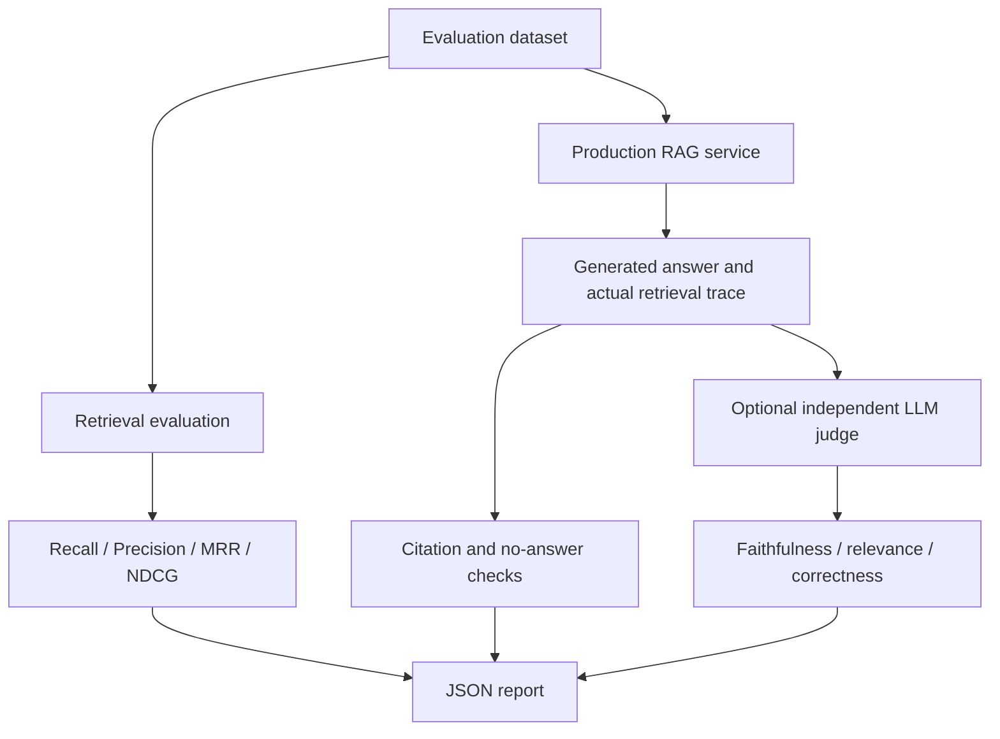
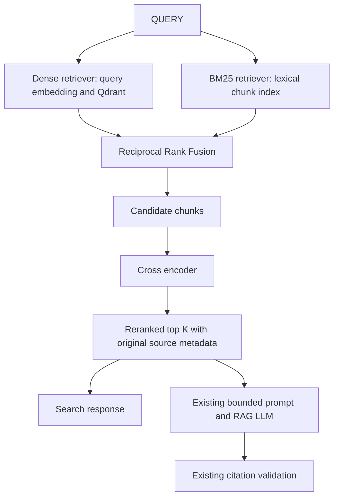

# Development reference

Detailed setup, API and evaluation instructions retained from the implementation documentation. Step-specific verification sections are historical snapshots; see [project status](project-status.md) for the current totals. For deployment use the [deployment guide](deployment.md).

## Setup: host-run FastAPI

Requirements: Python 3.11+, plus Docker with Compose to run the Qdrant server. The first real embedding operation needs internet access to download the model unless it is already cached. Embeddings then run on your CPU; document text is not sent to an embedding API.

From `deepdocs-ai`:

```bash
cd backend
python3 -m venv .venv
source .venv/bin/activate
# Windows PowerShell: .venv\Scripts\Activate.ps1
python -m pip install -r requirements.txt
cp .env.example .env
# Windows PowerShell: Copy-Item .env.example .env
cd ..
docker compose up -d qdrant
cd backend
python -m uvicorn app.main:app --reload
```

Keep `QDRANT_URL=http://localhost:6333` for host-run FastAPI. API: http://localhost:8000; Swagger: http://localhost:8000/docs; Qdrant HTTP: http://localhost:6333. Use reload only for development. `/health` is liveness, not model/Qdrant readiness.

## Full stack with Docker Compose

From `deepdocs-ai`:

```bash
cp backend/.env.example backend/.env
docker compose --env-file backend/.env up --build
```

Compose starts the non-root FastAPI container and Qdrant, with named volumes `qdrant_data` and `model_cache`. Ports 8000 and 6333 bind to localhost for local development. Qdrant stores vector payloads and text permanently in its volume; original uploads are not stored.

Inside Docker, FastAPI connects to `http://qdrant:6333`, not localhost. Compose overrides QDRANT_URL accordingly. `--env-file` supplies interpolation values such as model name and chunk settings; Compose does not mount your backend `.env`. APP_ENV and DEBUG are set explicitly for the container. Dependency ordering does not guarantee Qdrant is ready: if an early ingestion returns 503, retry once Qdrant is running.

```bash
docker compose down
```

This stops the services but preserves their named volumes. Avoid deleting volumes unless you intentionally want to erase the index/model cache. Docker builds include PyTorch dependencies and can take several minutes. For one-process local work without Docker, Qdrant's embedded fallback is available:

```bash
# From backend with the virtual environment active:
QDRANT_LOCAL_PATH=./.qdrant-local python -m uvicorn app.main:app
```

QDRANT_LOCAL_PATH takes precedence over QDRANT_URL. Embedded Qdrant has no HTTP server/port and must not share its directory between processes. Use server mode for multiple clients. This fallback is explicit; server connection failures never silently switch to local storage.

## Configuration

Pydantic Settings reads `backend/.env`, anchored to its absolute backend path. Process environment variables take precedence. Settings are validated at app creation; restart after changes. `python-dotenv` supplies dotenv parsing.

| Variable | Default | Meaning |
| --- | --- | --- |
| APP_NAME | `deepdocs-ai` | FastAPI title |
| APP_ENV | `development` | Environment label |
| DEBUG | `false` | Keep false for deployed use |
| CORS_ORIGINS | `["http://localhost:3000"]` | JSON array; wildcards rejected |
| MAX_UPLOAD_SIZE_MB | `10` | Positive integer; 1 MB = 1,048,576 bytes |
| CHUNK_SIZE | `1000` | Positive maximum cleaned characters per chunk |
| CHUNK_OVERLAP | `150` | Characters; 0 <= overlap < size |
| EMBEDDING_MODEL_NAME | `sentence-transformers/all-MiniLM-L6-v2` | Local open-source encoder or compatible local model path |
| EMBEDDING_BATCH_SIZE | `32` | 1–256 texts per embedding/upsert batch |
| QDRANT_URL | `http://localhost:6333` | Host default; Compose uses `http://qdrant:6333` |
| QDRANT_COLLECTION_NAME | `deepdocs_chunks` | Collection for one embedding space |
| QDRANT_LOCAL_PATH | unset | Optional single-process embedded storage path |

CORS permits GET and POST without credentials. It is a browser policy, not authentication. Inference is CPU-based for portability. The Hugging Face libraries also support `HF_HOME` for the cache directory and `HF_HUB_OFFLINE=1` to require cached files.

## Embedding lifecycle, dimensions, and batching

The default [all-MiniLM-L6-v2 model](https://huggingface.co/sentence-transformers/all-MiniLM-L6-v2) produces **384-dimensional** embeddings. The wrapper exposes the model's reported dimension instead of hardcoding it. It implements `embed_text` and `embed_texts`, validates output shape and finite values, and normalizes vectors. An empty text list returns `[]` without loading; blank individual texts are rejected.

The app lifespan owns one resource bundle: a lazy embedding wrapper, Qdrant client, and lock. The first ingestion/search loads the model once; subsequent calls reuse it. Health checks and normal unit tests never trigger a model download. A lock protects model initialization/inference, and the resource lock serializes indexing and search for this one-process implementation. The client closes at application shutdown. Synchronous parsing, inference, and Qdrant work run in a worker thread so the async event loop remains available.

Ingestion groups chunks into EMBEDDING_BATCH_SIZE batches. Each batch is encoded in one call, validated, and upserted with `wait=True`. This bounds intermediate vector memory and avoids one model call per chunk. Query encoding reuses the same wrapper.

Cosine similarity compares vector direction rather than magnitude and matches this sentence encoder's similarity training. Higher scores indicate closer embeddings; they are not probabilities or factual-confidence scores. MiniLM is intended for English sentences/short paragraphs and truncates beyond 256 word pieces. Character-based chunks do not guarantee fitting that token limit; reduce CHUNK_SIZE if truncation affects your documents. Token-aware chunking is a future improvement, not included here.

## Collection initialization and IDs

Before ingestion/search, the store creates a missing collection with the model's dimension and cosine distance. It validates an existing collection's dimensions, distance, and unnamed-vector layout. Mismatch returns **409** with migration guidance; no existing collection is recreated or destroyed.

To change embedding models, choose a **new QDRANT_COLLECTION_NAME and re-ingest**. Matching dimensions alone do not prove matching embedding spaces. The app cannot detect a same-dimension model change; do not mix models in one collection.

Document IDs are deterministic UUIDv5 values derived from the sanitized filename plus SHA-256 of the raw file bytes. Identical bytes under the same filename reuse the ID. Renaming a file or changing bytes creates a different document. Chunk IDs are valid UUIDv5 Qdrant point IDs derived from document ID and chunk index. Re-uploading replaces those points rather than duplicating them. After successful writes, trailing stale indexes are deleted if a new chunk configuration produced fewer chunks.

Each point has a normalized vector and this payload:

```json
{
  "chunk_id": "uuid",
  "document_id": "uuid",
  "text": "Original cleaned chunk text",
  "source_filename": "annual-report.pdf",
  "page_number": 7,
  "chunk_index": 18
}
```

PDF page numbers are one-based; document-wide chunk indexes are zero-based. TXT page metadata is null. UUIDs identify content, not access permissions.

## API examples

### Liveness

```bash
curl http://localhost:8000/health
```

```json
{"status":"ok","service":"deepdocs-ai"}
```

### Upload and index

Only `.pdf` / `application/pdf` and `.txt` / `text/plain` are accepted. MIME type and extension must agree. PDFs are parsed; TXT must be valid UTF-8 (optional BOM supported).

```bash
curl -X POST http://localhost:8000/documents/upload \
  -F "file=@sample.pdf;type=application/pdf"

curl -X POST http://localhost:8000/documents/upload \
  -F "file=@sample.txt;type=text/plain"
```

```json
{
  "document_id": "5bb2cba4-973a-57c7-923d-ce2d169015c3",
  "filename": "finance.txt",
  "content_type": "text/plain",
  "page_count": null,
  "chunk_count": 1,
  "indexed_chunk_count": 1
}
```

Upload responses no longer contain every chunk. A 200 response means every chunk was written and stale-point cleanup completed.

### Semantic search

```bash
curl -X POST http://localhost:8000/search \
  -H 'Content-Type: application/json' \
  -d '{"query":"What were the major risks in the report?","top_k":5}'
```

Limit results to one document using the ID returned by upload:

```bash
curl -X POST http://localhost:8000/search \
  -H 'Content-Type: application/json' \
  -d '{"query":"revenue growth","top_k":5,"document_id":"5bb2cba4-973a-57c7-923d-ce2d169015c3"}'
```

```json
{
  "query": "revenue growth",
  "results": [{
    "chunk_id": "6671dff5-152d-5cff-97c1-607a5455c2ba",
    "document_id": "5bb2cba4-973a-57c7-923d-ce2d169015c3",
    "text": "Annual revenue grew twenty percent as sales increased.",
    "source_filename": "finance.txt",
    "page_number": null,
    "chunk_index": 0,
    "score": 0.82
  }]
}
```

The example score is illustrative. Queries are trimmed, must be nonempty, and are limited to 10,000 characters. top_k must be an integer from 1 through 20. document_id must be a UUID. The filter is sent to Qdrant as an exact-match payload condition **before ranking**, not applied after selecting top K. Unknown IDs and empty collections return an empty result list. Future metadata filters can be added to SearchRequest. The `/search` endpoint performs no answer generation or relevance thresholding. Step 6 enables optional reranking through settings. Use `/ask` for the optional generation step.

## Upload and chunking safeguards

The request-body middleware bounds multipart spooling to MAX_UPLOAD_SIZE_MB plus 64 KiB for overhead, including requests without Content-Length. The service checks the exact file limit and reads bounded blocks. Upload files are closed after processing. Filename path components are stripped and never used to write files.

Cleaning normalizes line endings and horizontal whitespace while preserving paragraph breaks. The chunker prefers paragraphs, newlines, sentence endings, then spaces; hard splits are a fallback. Boundaries are chosen in the latter half of the window beyond overlap to ensure progress. Chunks never exceed CHUNK_SIZE. Overlap is measured in cleaned characters; trimming can reduce visible overlap. Empty and identical same-page chunks are removed; repeated text on different pages is retained for citations. No chunk or overlap crosses a PDF page boundary. Blank pages retain their original numbering but emit no chunks.

## Errors and tradeoffs

| HTTP status | Condition |
| --- | --- |
| 400 | Empty file or malformed multipart request |
| 409 | Collection/vector dimension or distance mismatch |
| 413 | File or total request exceeds its limit |
| 415 | Unsupported or mismatched MIME type/extension |
| 422 | Missing file, invalid UTF-8/PDF, encrypted/scanned/empty-text PDF, blank query, invalid top_k or document_id |
| 503 | Model loading/inference failure, Qdrant unavailable, write/search/cleanup failure |

Expected dependency errors return safe `detail` messages without underlying stack traces. An early request-body limit rejection may return plain text. An unavailable Qdrant returns 503 on ingestion/search; liveness remains available. Correct the URL/start Qdrant, then retry. A missing uncached model requires network access or a valid local model path.

Batched indexing is **not a transaction across the whole document**. A failure can leave partial points or stale points; retrying the identical upload converges through deterministic upserts and cleanup. The application does not roll back or falsely report full success. The process lock prevents local requests from interleaving ingestion/search, but does not coordinate multiple FastAPI workers. Use one worker for this step. Documents with changed bytes are separate revisions and old revisions remain searchable; deletion/version management is outside scope.

Embedded Qdrant is a development/test fallback, not a substitute for testing the network service. Collection checks occur per operation, adding small overhead. For larger indexes, a document_id payload index and worker/concurrency design may help. PDF extraction fidelity depends on the text layer; no OCR is provided. Compressed PDFs can consume more CPU/memory than their upload byte size, and worker threads are not resource-isolated processes. Authentication and multi-user authorization are not implemented.

## Tests

From `backend`, with the virtual environment active:

```bash
python -m pytest -q
```

Normal tests use injected deterministic embeddings and real in-memory Qdrant. They do not import/load a real model or require internet or a running database. Embedding-wrapper tests inject a fake model loader. The opt-in integration test is skipped by default.

To explicitly test the real model with in-memory Qdrant (first run may download the model):

```bash
RUN_EXTERNAL_INTEGRATION=1 python -m pytest tests/integration -q
```

To also test a running Qdrant server:

```bash
RUN_EXTERNAL_INTEGRATION=1 QDRANT_TEST_URL=http://localhost:6333 \
  python -m pytest tests/integration -q
```

The integration test creates a uniquely named test collection and deletes only that collection in cleanup. Once the model is cached, add `HF_HUB_OFFLINE=1` to prohibit model network access. That mode was used for final local verification.

## Step 4: answer generation with citations

`/ask` reuses `search_documents` without duplicating search logic. Retrieval runs in a worker thread; the asynchronous provider request runs after the indexing lock is released. An application-owned HTTPX client is reused and closed at shutdown. The `LLM` protocol requires only:

```python
async def generate(system_prompt: str, user_prompt: str) -> str:
    ...
```

Provider-specific headers, URL construction, request/response handling, and errors stay in `app/rag/llm.py`. Tests can inject an implementation through `create_app(..., llm=fake)` or override the `get_llm` dependency. No new runtime package is needed: the adapter uses existing HTTPX.

### Run without an LLM

Leave LLM_MODEL and LLM_API_KEY blank. Health checks, ingestion, and semantic search continue to work. `/ask` retrieves first: if no sources exist, it returns the deterministic no-results response without a provider call. If context exists but generation is unconfigured, `/ask` returns 503 with setup guidance. Merely starting the application never calls an LLM.

### Configure generation

Edit the ignored `backend/.env` file, then restart FastAPI:

```dotenv
LLM_PROVIDER=openai_compatible
LLM_MODEL=your-provider-chat-model-id
LLM_API_KEY=your-provider-key
LLM_BASE_URL=https://api.openai.com/v1
LLM_TEMPERATURE=0.1
LLM_MAX_OUTPUT_TOKENS=800
LLM_TIMEOUT_SECONDS=30
RAG_TOP_K_DEFAULT=5
RAG_MAX_CONTEXT_CHARS=12000
```

The model and key above are placeholders. Select a model available from your provider that supports Chat Completions, system messages, temperature, and `max_completion_tokens`. This adapter intentionally uses the Chat Completions interface for compatibility; it does not use the Responses API or claim support for every vendor/model variation. A rejected parameter/model request produces a safe 503. No model is selected automatically and no real provider call is made during normal tests.

LLM_BASE_URL is the API prefix, normally ending in `/v1`; the adapter appends `/chat/completions`. The same adapter can target a compatible local server. A nonempty key is required; use a non-secret placeholder only when your local server explicitly accepts it. Do not place credentials in the URL. The provider receives the question and the selected source text when `/ask` generates; local sentence embeddings remain local.

For Compose, the existing command forwards these values:

```bash
docker compose --env-file backend/.env up --build
```

A local provider running on the host is not the container's localhost; configure an address reachable from the container. Keep keys in `.env`/environment settings, not source files. Settings use Pydantic SecretStr to redact key representations; no API key is inserted into the LLM prompt.

| Setting | Default | Validation |
| --- | --- | --- |
| LLM_PROVIDER | `openai_compatible` | Supported value checked only when generating |
| LLM_MODEL | blank | Must be nonblank when generating |
| LLM_API_KEY | blank | Must be nonblank when generating |
| LLM_BASE_URL | `https://api.openai.com/v1` | HTTP(S), without URL credentials, query, or fragment |
| LLM_TEMPERATURE | `0.1` | 0–2; low default for factual QA |
| LLM_MAX_OUTPUT_TOKENS | `800` | 1–8192, sent as max_completion_tokens |
| LLM_TIMEOUT_SECONDS | `30` | Greater than 0, up to 300; HTTP and overall generation deadlines |
| RAG_TOP_K_DEFAULT | `5` | 1–20; used when request top_k is omitted or null |
| RAG_MAX_CONTEXT_CHARS | `12000` | 256–100000 serialized source characters |

### Ask API

```bash
curl -X POST http://localhost:8000/ask \
  -H 'Content-Type: application/json' \
  -d '{"question":"What are the major risks in the report?","top_k":5}'
```

With a document filter (replace the UUID with your upload response's ID):

```bash
curl -X POST http://localhost:8000/ask \
  -H 'Content-Type: application/json' \
  -d '{"question":"What are the major risks?","document_id":"62f75e07-352e-5b80-a791-9f12d38427e1"}'
```

Illustrative response:

```json
{
  "question": "What are the major risks?",
  "answer": "The risks are supply-chain disruption and regulatory exposure [1].",
  "citations": [{
    "source_number": 1,
    "chunk_id": "49a05ee1-8304-572c-a81d-665c71e2d789",
    "document_id": "62f75e07-352e-5b80-a791-9f12d38427e1",
    "source_filename": "risks.pdf",
    "page_number": 3,
    "chunk_index": 1
  }]
}
```

Questions are stripped, must be nonempty, and have a 2,000-character maximum. top_k is an integer from 1 to 20; document_id is an optional UUID with the same filtering behavior as `/search`. Invalid requests return 422.

### Prompt structure and grounding

The provider receives a separate system message and a JSON user message containing `question` and `sources`. Each reference item has an application-generated source number, `[Source N]` marker, filename, original page number, text, and a truncation flag. JSON escaping prevents document strings from changing the structure of the reference array or creating real provider message roles.

System instructions require answers from supplied context only, citations on factual claims, no invented facts or source markers, and an exact insufficient-information response when the answer is absent. Filenames and page numbers in returned citation objects always come from retrieval, never from the model.

If retrieval returns no chunks, generation is skipped and the API responds:

```json
{
  "question": "Your question",
  "answer": "I could not find relevant information in the indexed documents.",
  "citations": []
}
```

When retrieved context does not contain the answer, the instructed fallback is:

```text
The provided documents do not contain enough information to answer this question.
```

That exact model response is returned with no citations. Unlike empty retrieval, this case requires the model to assess the context; semantic top-K search alone does not establish that an answer exists.

### Citation mapping and context limits

Source numbers are one-based and deterministic within each built prompt, following retrieval order. They are not permanent document identifiers. Each maps to a stored chunk and its original document/page metadata. Duplicate retrieved chunk IDs are omitted.

The context budget counts the entire serialized sources array, including markers and metadata. The question is separately bounded, and fixed system instructions sit outside this budget. Whole chunks are included in rank order until the limit; the final chunk's text can be shortened to fit using a binary search over character prefixes. Markers, JSON structure, filenames, and page numbers are never cut. If even metadata plus usable text cannot fit, no LLM call is made and the insufficient-information response is returned. Future tokenizer-aware budgeting can account for provider-specific token windows more precisely.

Only markers referenced by the answer are mapped to citations, in first-use order. Repeated `[1]` references yield one citation entry. Unknown numbers, unsupported numeric groups such as `[1,2]`, or an answer without citations (other than the exact fallback) fail closed with 503; the answer is not returned. Sources excluded by the context budget cannot become citations.

These checks prove **citation provenance, not factual entailment**. A model can still attach a valid marker to an unsupported claim or invent metadata in narrative prose; the application-generated citation objects remain correct. These runtime checks do not add an entailment verifier; Step 5 supplies separate offline evaluation.

### Prompt-injection protections and limits

All retrieved text and metadata are explicitly untrusted reference data. The system prompt says document instructions cannot override system instructions, and specifically rejects requests to ignore instructions, reveal prompts, impersonate roles, or dictate an answer. The question cannot override grounding rules either. No tools, secret API keys, or code execution capability are exposed to the model.

JSON framing, instruction hierarchy, and citation validation reduce risk but do not make a probabilistic model immune to prompt injection. Deterministic tests verify the message boundaries and expected fake-provider behavior; they do not prove that an arbitrary real provider will always resist malicious documents. No real paid LLM robustness test was performed. Model quality, unsupported factual claims, prompt leakage, and arbitrary narrative text remain known limitations.

### Generation failures and logging

Missing/invalid generation configuration, provider authentication failure, network failure, rate limit, timeout, non-success response, malformed/empty response, incomplete output, and invalid citations return safe 503 errors. Provider bodies, prompts, keys, and internal exceptions are not returned. The adapter does not follow redirects with credentials, caps the response body at 1 MiB, and does not automatically retry potentially billable requests. Existing embedding/Qdrant errors retain their safe 503 or collection-mismatch 409 responses.

Minimal JSON events are emitted via the `uvicorn.error.deepdocs.rag` logger for request receipt, retrieved chunk count, and generation latency/provider/model/success. Logs omit question text, full source text, full prompts, document IDs, and API keys. Provider and model labels are operator configuration, not document content.

## Verification performed

- Complete offline normal suite: **140 passed, 1 optional integration test skipped**.
- Normal tests inject fake LLMs or use HTTPX MockTransport; no paid provider calls.
- Existing health, parsing, chunking, ingestion, and search tests still pass.
- Tests cover citation provenance/page mapping, duplicate/invalid markers, filtering, missing configuration, no-result call avoidance, absent-answer fallback, prompt-injection framing, context limits, secret-safe errors/logging, and generation deadlines.
- Live Step 4 verification passed using cached real MiniLM embeddings, persistent embedded Qdrant, and a local fake OpenAI-compatible HTTP provider. TXT/PDF ingestion, semantic search, `/ask`, PDF page-3 citation matching, absent-fact fallback, prompt-injection framing, and no-result call avoidance succeeded. Uvicorn and the fake provider shut down cleanly. This checks actual HTTP adapter behavior without claiming real-model answer quality.
- Docker remains unavailable: Compose/container execution and a separate Qdrant server have not been verified here.
- Two existing Starlette/AnyIO deprecation warnings remain.

The preceding checks document Step 4. Step 5 verification is recorded below. Package requirements remain unchanged.

## Step 5: RAG evaluation

A working endpoint and valid source identifiers do not prove that retrieval finds the right evidence or that an answer is supported. Evaluate retrieval and generation separately to locate failures. The evaluation package reuses production `search_documents` and `ask_question`; it does not change `/search`, `/ask`, their prompts, or their response schemas.



### Dataset format

Use a JSON array or one JSON object per line in JSONL. See `backend/evaluation/examples/demo.jsonl`. Each record has:

```json
{
  "id": "growth",
  "question": "What was revenue growth?",
  "expected_document_id": "5ad93325-05ef-564f-8533-a20cf51e3456",
  "expected_chunk_ids": ["c7a57974-f4b9-5879-958c-28609e4d1b37"],
  "reference_answer": "Revenue grew by 20% in 2025.",
  "expects_no_answer": false,
  "tags": ["demonstration"],
  "difficulty": "easy",
  "category": "fictional-business"
}
```

IDs above illustrate the schema; use the actual IDs in the supplied dataset or your indexed collection. `id` must be unique within the dataset. Questions are nonblank and at most 2,000 characters; references are nonblank and at most 10,000 characters. UUIDs, duplicate labels, unknown fields, empty datasets, invalid JSON, and datasets exceeding 10 MiB are validated before evaluation.

`expected_chunk_ids` is a set of relevant judgments, supporting multiple relevant chunks. `expected_document_id` is optional and restricts which returned chunks can count as relevant. It is **not automatically supplied as a search filter**, which would leak ground truth into retrieval. Use the separate optional `filter_document_id` when a question deliberately asks about one document. Leave expected_document_id unset for cross-document evidence.

For unanswerable questions, set `expects_no_answer: true`. An empty expected_chunk_ids list is permitted only with this explicit label. Nonempty relevant context and an expected refusal are also permitted when related sources do not actually answer the question. Human-reviewed, reasonably complete relevance judgments and reference answers are necessary; missing labels can falsely penalize good retrieval. IDs can change when document content/chunking changes, so update judgments with the corpus.

### Retrieval metrics

The runner requests top `max(K)` once per case, with K = 1, 3, 5 by default. In RAG mode the production ask service performs that retrieval, and evaluation records its results; it does not run a second search. Scores are macro-averages across scorable cases.

- **Recall@K** = unique relevant chunks retrieved in the first K / total labeled relevant chunks. This is standard set recall, not a binary hit-rate. Retrieving one of two relevant chunks gives 0.5.
- **Precision@K** = unique relevant chunks in the first K / K. The denominator remains K when fewer results are returned; missing positions contribute zero.
- **MRR** = mean reciprocal rank of the first relevant result, or zero when none is found. Here MRR is truncated to the retrieval depth, normally 5; it is not a claim about ranks beyond those retrieved.
- **NDCG@K** uses binary gain: `DCG@K = sum(rel_i / log2(i + 1))` for ranks i from 1 to K. Divide by the ideal DCG with all relevant results first, up to `min(K, number of relevant chunks)`. Higher-ranked evidence receives more credit.

Duplicate returned IDs get credit only at their first occurrence and still occupy their original rank positions. Low-level metrics return zero for empty relevance sets; the report flags such cases `retrieval_scorable: false` and excludes them from aggregate retrieval metrics rather than claiming retrieval quality without positive judgments. They remain eligible for no-answer and generation checks.

Manual example: relevant IDs are A and B; returned ranking is `[noise, A, B]`.

| Metric | Result |
| --- | --- |
| Recall@1 / Precision@1 | 0 / 0 |
| Recall@3 | 2/2 = 1 |
| Precision@3 | 2/3 |
| Precision@5 | 2/5, even though only 3 results returned |
| Reciprocal rank | 1/2 |
| NDCG@3 | `(1/log2(3) + 1/log2(4)) / (1 + 1/log2(3))` ≈ 0.693426 |

This is the synthetic `growth-and-risks` replay case and a unit-test assertion, not a measured model result.

### Generation metrics: deterministic checks first

Deterministic generation results are reported separately from optional judge scores:

- `citation_validity`: fraction of returned citation records exactly matching sources included in the bounded production prompt, including document/chunk IDs, filename, page, index, and source number. A citation-free canonical fallback scores 1; an uncited substantive answer scores 0.
- `citation_markers_valid`: markers and returned citation records agree; duplicate citation records, unknown markers, and mismatched metadata fail. Repeated markers in prose are allowed.
- `citation_sentence_coverage_proxy`: fraction of nonempty sentence-like spans containing a numeric citation marker. This is a heuristic, not factual-claim detection or support verification; evaluate validity alongside it.
- `no_answer_correct`: canonical fallback with no citations when the dataset expects no answer, and no fallback when an answer is expected. It checks refusal behavior, not the correctness of a substantive answer.
- `question_token_recall_proxy`: fraction of non-stopword question tokens present in the answer, a weak lexical relevance signal.
- `context_token_support_proxy`: fraction of answer tokens present in the actual bounded context, a weak groundedness signal.
- `reference_token_f1_proxy`: set-token F1 between answer and reference, rather than full-string equality.

Lexical proxies use lowercase Unicode word tokens, remove numeric citation markers, and exclude a small fixed stopword list. They cannot reliably handle paraphrases, negation, numbers with changed meaning, multilingual semantics, or unsupported combinations of otherwise present words. They are null for fallback answers. **Do not treat these proxy values as faithfulness or semantic correctness scores.**

### Optional LLM judge

`--judge` explicitly enables a separate `Judge` abstraction. `LLMJudge` requests a JSON object with scores in [0, 1] and a short reason:

- **Faithfulness:** are the answer's claims supported by the context actually sent to generation?
- **Answer relevance:** does the answer address the question?
- **Correctness:** does it agree with the key facts in the reference answer, including appropriate refusal?

The rubric anchors 0 as unsatisfactory, 0.5 as partial, and 1 as fully satisfactory. Output is parsed into a strict Pydantic schema; missing/extra fields, nonfinite/out-of-range scores, invalid JSON, and timeouts are errors rather than fabricated scores. JSON is requested and validated; the adapter does not enforce a provider-specific constrained-output schema.

Configure the judge independently in `backend/.env`:

```dotenv
EVAL_JUDGE_PROVIDER=openai_compatible
EVAL_JUDGE_MODEL=your-judge-model-id
EVAL_JUDGE_API_KEY=your-judge-key
EVAL_JUDGE_BASE_URL=https://api.openai.com/v1
EVAL_JUDGE_TIMEOUT_SECONDS=30
EVAL_JUDGE_MAX_INPUT_CHARS=60000
```

Judge settings never fall back to the production LLM key or model. The judge uses temperature 0 and up to 1,200 output tokens. All question, answer, context, and reference fields are JSON data below a separate judge system rubric. Instructions contained in any field cannot legitimately override that rubric. No production credentials are included. Inputs above the judge character budget fail instead of silently dropping evidence.

A real judge is still probabilistic and susceptible to bias, prompt injection, reference errors, and superficial style preferences. A shared model family may have correlated errors with generation. Scores require human calibration and should not be compared across changed rubrics/models without care. Prompt separation is not a guarantee of injection immunity. Judges may incur cost and receive evaluation content; enable them intentionally. Reports can contain judge reasons and source IDs, so treat private-dataset reports as potentially sensitive.

### Latency

Evaluation-only wrappers use monotonic `perf_counter()` timers without changing production services:

- `retrieval`: the production synchronous search stage, including its lock wait, dimension lookup/model load, collection check, query embedding, and Qdrant search; excludes scheduling into the worker thread.
- `embedding`: dimension lookup and query encoding, including lazy model loading if needed. It is a subset of retrieval, not an additional non-overlapping stage.
- `generation`: the production LLM generate call when actually invoked, including provider/network time.
- `rag`: the complete ask service call, including retrieval, prompt building, generation, and citation mapping; excludes evaluation and judge work.
- `judge`: the optional real judge call, measured separately.

Each stage reports count, mean, P50, and P95. Percentiles use linear interpolation at index `(n-1)*p` after sorting. Unexecuted stages report count 0 and null summaries, not zero latency. Recorded failed attempts are included in latency summaries. No warmup is discarded: the first model load can dominate tiny runs. These are CPU/wall-clock measurements, not GPU instrumentation. Synthetic replay leaves stage timings null.

### Run evaluation

From `backend`, with the virtual environment active and the dataset's corpus already indexed:

```bash
python -m app.evaluation.run \
  --dataset evaluation/your_dataset.jsonl \
  --retrieval-only \
  --output evaluation/results/retrieval.json
```

Retrieval-only mode never constructs/calls an answer LLM or judge. For normal production generation, configure LLM_* first:

```bash
python -m app.evaluation.run \
  --dataset evaluation/your_dataset.jsonl \
  --output evaluation/results/rag.json

# Explicit opt-in to real judge calls:
python -m app.evaluation.run \
  --dataset evaluation/your_dataset.jsonl --judge \
  --output evaluation/results/rag-judged.json
```

Use `--ks 1 3 5` to choose cutoffs (unique integers from 1 to 20). RAG generation uses the maximum requested K. Combining retrieval-only and any judge flag is rejected. Exit code 0 means all cases completed; 1 means the report includes case/judge errors; 2 means input/configuration/report setup failed. Failed cases are retained with safe messages, and metrics are averaged over available observations with explicit counts. Always inspect errors and scored counts to avoid survivor bias. A judge error preserves deterministic generation metrics. Reports are written through a temporary file and include a dataset SHA-256, per-case results, execution mode, and relevant configuration.

### Runnable fictional demo

The bundled corpus has three short TXT documents and five questions. It demonstrates multiple relevant chunks, filtering, and an unanswerable case. It is far too small and simple to establish real model quality.

Prepare the demo using real embeddings in an isolated embedded-Qdrant directory:

```bash
python -m app.evaluation.prepare_demo --storage evaluation/.qdrant-demo
QDRANT_LOCAL_PATH=./evaluation/.qdrant-demo \
QDRANT_COLLECTION_NAME=deepdocs_eval_demo \
python -m app.evaluation.run --dataset evaluation/examples/demo.jsonl \
  --retrieval-only --output evaluation/results/demo-retrieval-real.json
```

The preparer reads `evaluation/examples/corpus.json` and uses production ingestion with fixed chunk settings matching the supplied IDs. It does not write to the production collection. First use may download MiniLM; with the model cached, `HF_HUB_OFFLINE=1` prevents downloads. The demo's unknown-document filter deliberately demonstrates empty retrieval, not general out-of-domain detection.

For fully offline calculation examples requiring neither a model nor a database:

```bash
python -m app.evaluation.run --dataset evaluation/examples/demo.jsonl \
  --replay evaluation/examples/replay.json --retrieval-only \
  --output evaluation/results/demo-retrieval-replay.json

python -m app.evaluation.run --dataset evaluation/examples/demo.jsonl \
  --replay evaluation/examples/replay.json --fake-judge \
  --output evaluation/results/demo-fake-judge.json
```

Replay contains intentionally synthetic retrieved rankings, answers, and fixed judge scores. Reports identify `synthetic_replay_not_model_quality` and `synthetic_fixture_scores`. The fake-judge run demonstrates plumbing and serialization; it is not an assessment by an LLM. No paid provider calls occur. Real-judge replay is disallowed to keep the modes explicit.

### Evaluation code layout

Production API/routes remain untouched. `app/evaluation/` owns datasets, metrics, service instrumentation, answer checks, judge settings/adapter, reports, replay, and CLI. `evaluation/examples/` holds demonstration data; `evaluation/results/` holds ignored generated reports; `tests/evaluation/` contains deterministic unit and service-integration tests. No new package dependency was required. Normal tests use fake embeddings/answers/judges and in-memory Qdrant, without internet access.

Metric references: [Stanford's evaluation of ranked retrieval](https://nlp.stanford.edu/IR-book/html/htmledition/evaluation-of-ranked-retrieval-results-1.html) and [scikit-learn's NDCG documentation](https://scikit-learn.org/1.5/modules/generated/sklearn.metrics.ndcg_score.html).

### Step 5 verification results

- Full offline suite: **191 passed, 1 optional integration test skipped**, with two existing Starlette/AnyIO deprecation warnings.
- Real cached MiniLM + isolated embedded Qdrant retrieval: five demo queries, zero errors, four retrieval-scored queries. Recall@1 = 0.875; Recall@3 = Recall@5 = 1; MRR = 1; Precision@5 = 0.25. This is demonstration coverage only, not a quality benchmark.
- Real retrieval latency: mean approximately 997.48 ms, P50 10.67 ms, P95 3958.49 ms. The first model load is included, explaining the skew; no GPU metrics were collected.
- Synthetic retrieval replay and fake-judge generation replay: five cases each, zero errors. Fake judge values are fixed fixture inputs, not real semantic scores, and synthetic stage timings are null.
- Manual multi-relevant replay calculation confirmed Recall@3 = 1, Precision@3 = 2/3, reciprocal rank = 1/2, and NDCG@3 = 0.693426404.
- Reports are saved under `backend/evaluation/results/`: `demo-retrieval-real.json`, `demo-retrieval-replay.json`, and `demo-fake-judge.json`.
- Production `/search` and `/ask` implementations were not changed; their existing tests still pass. No paid provider calls were made. These were the historical Step 5 checks; Step 6 results follow below.

## Step 6: retrieval quality optimization

The production default remains `RETRIEVAL_STRATEGY=dense`. Both `/search` and `/ask` use the same search service and configured retriever; API request shapes and citation identifiers are unchanged. Strategy selection belongs in settings, while the comparison CLI explicitly evaluates all four strategies. API routes do not depend on BM25 or cross-encoder implementations.



This diagram shows `hybrid_rerank`. Dense and BM25 bypass fusion and reranking; hybrid bypasses the cross encoder.

### Character and token chunking

Character chunking remains available and is the default for backward compatibility. It budgets characters, which cannot guarantee an embedding token limit. Token chunking loads the configured embedding model's fast tokenizer and uses offsets into cleaned page text. It prefers paragraph, newline, sentence, then space boundaries in the latter part of the window; hard token boundaries are the fallback. It overlaps source token windows, removes empty/identical chunks within each page, and never combines pages. File, page, document and chunk identifiers follow the existing ingestion path.

Default MiniLM accepts 256 tokens including special tokens. `TOKEN_CHUNK_SIZE=200` reserves room for its two special tokens, and `TOKEN_CHUNK_OVERLAP=32` is measured in source tokens, not characters. Every resulting substring is re-tokenized and checked against the budget because WordPiece splitting can change at substring boundaries. Validation rejects incompatible budgets or overlap with HTTP 409. Fast tokenizers with offsets are required. Custom embedding models with extra prompt prefixes need an appropriately smaller budget; this implementation does not add embedding prompts.

Changing chunk settings does not automatically reindex old documents. Re-upload documents to rebuild their chunks and update evaluation labels where IDs change. The strategy comparison below deliberately keeps the existing character-chunked demo corpus fixed, so it isolates retrieval strategy, not the effect of token chunking. Token mode has separate deterministic and real-tokenizer tests. Query and cross-encoder pair lengths still follow their model limits.

### Dense, lexical and hybrid retrieval

A bi-encoder embeds query and chunks separately. Chunk vectors are stored once; querying compares the query vector against Qdrant cosine scores. This captures paraphrases but may miss exact identifiers or rare terminology.

BM25 is sparse lexical retrieval: it scores matching lowercase Unicode word tokens, not substrings. Term frequency (TF) rewards occurrences with saturation; inverse document frequency (IDF) rewards terms present in fewer chunks; document length normalization prevents long chunks winning just because they contain more words. Defaults are `k1=1.5` and `b=0.75`:

```text
IDF(t) = log(1 + (N - df(t) + 0.5) / (df(t) + 0.5))
score = sum IDF(t) * tf(t,d)*(k1+1)
                  / (tf(t,d) + k1*(1-b+b*length(d)/average_length))
```

Query terms are unique; repeated query words do not boost scores. No stemming or stopword removal is applied. Only positive lexical matches are returned. Statistics use the whole corpus, while document filters restrict eligible results before top-K selection. Exact token matching can help domain terminology but does not understand paraphrases.

The dedicated BM25 abstraction lazily builds an in-memory index from Qdrant's canonical text payloads. There is no second persistent store: IDs and source metadata remain identical. Application ingestion invalidates this cache after successful or partially failed writes; restart rebuilds it. The shared application lock serializes ingestion and retrieval. External writes require a restart to refresh this cache. This single-process, full-corpus in-memory design is suitable for the current portfolio scale, not an unbounded multi-worker deployment.

Hybrid retrieves a broader candidate pool from both branches, then applies `sum(1/(RRF_CONSTANT + rank))`, using one-based ranks and default constant 60. It never adds cosine and BM25 scores directly. Duplicate chunk IDs contribute once per branch; deterministic ID tie-breaking preserves stable results. Branch depth is the maximum of final top-K and both configured candidate counts. Reranking consumes at most the larger of top-K and `RERANK_CANDIDATE_COUNT`; hybrid alone returns the fused top-K.

### Cross-encoder reranking

A cross encoder processes each (query, chunk) pair together, allowing fine-grained interactions that separate embeddings cannot capture. This costs inference per candidate, so only a small retrieved set is reranked. It cannot recover a relevant chunk missing from that set.

The configurable default is `cross-encoder/ms-marco-MiniLM-L6-v2` (the actual model ID uses `L6`). It loads lazily on CPU, is reused, and batches pairs. Weights are copied into owned CPU storage after loading: this resolved a native mmap-backed linear-layer crash on the verification machine without changing model weights or substituting scores. This incurs an extra transient weight copy.

Model-load or scoring exceptions return a safe HTTP 503; there is no silent fallback to hybrid. Empty candidates bypass model loading. Results retain source metadata. The response `score` is strategy-specific: cosine, BM25, RRF, or native cross-encoder relevance. These scores are not interchangeable probabilities.

### Configuration and usage

| Variable | Default |
|---|---|
| CHUNKING_STRATEGY | character (or token) |
| TOKEN_CHUNK_SIZE | 200 |
| TOKEN_CHUNK_OVERLAP | 32 |
| RETRIEVAL_STRATEGY | dense (or bm25, hybrid, hybrid_rerank) |
| RETRIEVAL_CANDIDATE_COUNT | 20 |
| RRF_CONSTANT | 60 |
| RERANKER_MODEL_NAME | cross-encoder/ms-marco-MiniLM-L6-v2 |
| RERANK_CANDIDATE_COUNT | 20 |
| RERANKER_BATCH_SIZE | 16 |

Both character and token overlap must be less than their respective chunk sizes. Candidate counts are bounded at 200; API top-K remains at most 20. Settings are available through environment variables, `.env.example`, and Docker Compose. No additional Python dependency was necessary: sentence-transformers already supplies the cross encoder and tokenizer.

From `backend/`, after installing requirements and preparing the demo corpus as described in Step 5:

```bash
python -m app.evaluation.compare --dataset evaluation/examples/demo.jsonl   --output evaluation/results/step6-comparison.json --warmup 1
```

Use the same `QDRANT_LOCAL_PATH` and `QDRANT_COLLECTION_NAME` that were used for demo ingestion. First use needs access to download both models; cached runs can set `HF_HUB_OFFLINE=1`. Reports contain per-case results, dataset hash, model/settings metadata and stage timings. One warmup query per strategy excludes initialization from measured queries. Dense, BM25, hybrid (including fusion), reranking and total retrieval are recorded; nested stage timings must not be added twice. Total includes service/lock overhead. The CLI exits nonzero on evaluation errors and writes JSON plus Markdown.

```bash
pytest -q
RUN_RETRIEVAL_MODELS=1 RUN_EXTERNAL_INTEGRATION=1 pytest -q
CHUNKING_STRATEGY=token RETRIEVAL_STRATEGY=hybrid_rerank uvicorn app.main:app
curl -X POST http://localhost:8000/search   -H 'Content-Type: application/json' -d '{"query":"revenue growth","top_k":5}'
```

Ordinary tests use injected deterministic models and never download real models. The second test command explicitly enables real embedding and reranker checks.

### Measured demo comparison and architecture decision

The following is an actual CPU run with real MiniLM embeddings, embedded Qdrant, and the real cross encoder on a **synthetic demonstration corpus**: three short fictional documents, five queries, four retrieval-scored cases, one no-answer filtered case. All strategies use the same corpus and labels. No LLM or judge is used. Latency includes all five measured queries, including the empty-result case. This is a single warmed run on a development machine, not a statistically reliable benchmark.

| Retriever | Recall@5 | MRR | NDCG@5 | P50 retrieval (ms) |
|---|---:|---:|---:|---:|
| dense | 1.000 | 1.000 | 1.000 | 10.360 |
| bm25 | 1.000 | 1.000 | 1.000 | 0.028 |
| hybrid | 1.000 | 1.000 | 1.000 | 8.396 |
| hybrid_rerank | 1.000 | 1.000 | 1.000 | 17.572 |

All four have zero evaluation errors. The JSON report includes individual stage distributions; the companion Markdown includes reranking P50.

**Keep dense as the production default.** Hybrid and reranking show no Recall/MRR/NDCG gain here. BM25 is much faster on this tiny cached corpus, but that does not demonstrate general semantic quality. Differences of a few milliseconds between dense and hybrid in a five-query run should be treated as measurement variation. Perfect scores are a ceiling effect on an easy dataset, not proof of production retrieval quality.

Feature development stops after Step 6. The next analysis should use a larger independently labeled corpus with distractors, paraphrases, rare identifiers, multi-page answers and unanswerable questions; repeat warmed runs, report uncertainty and inspect per-query failures. Keep the alternatives available for those experiments, but do not promote hybrid or reranking without a measurable gain that justifies latency. This work does not implement Step 7.

### Step 6 verification

- Full suite with real integrations explicitly enabled: **228 passed**, two existing Starlette/AnyIO deprecation warnings.
- Default suite: **225 passed, 3 real-model tests skipped**.
- Four actual strategy evaluations: zero errors, full reports in `backend/evaluation/results/step6-comparison.json` and `.md`.
- Live Uvicorn: Swagger, token-mode TXT/PDF ingestion, real hybrid reranked `/search`, and `/ask` citation identity/page mapping verified.
- Generation used a local fake OpenAI-compatible HTTP provider; no paid LLM calls or claims of real generation quality.
- Docker configuration was updated; Docker execution was not revalidated because Docker is unavailable in this environment.

Primary references: [BM25](https://nlp.stanford.edu/IR-book/html/htmledition/okapi-bm25-a-non-binary-model-1.html), [RRF](https://docs.opensearch.org/latest/vector-search/ai-search/hybrid-search/rrf/), and the [cross-encoder model card](https://huggingface.co/cross-encoder/ms-marco-MiniLM-L6-v2).

## Real-document benchmark infrastructure

The benchmark workspace now supports manifest-based ingestion, complete chunk inventories,
manually reviewed JSONL labels, annotation candidate previews, repeated four-strategy comparisons,
per-category metrics, and JSON/Markdown failure reports. No production retrieval feature was added.

Start with [the benchmark workflow](../backend/evaluation/benchmark/README.md) and
[the twelve incomplete question templates](../backend/evaluation/benchmark/datasets/questions.template.jsonl).
The real v1 benchmark has now been completed: seven annual reports, 11,769 indexed chunks and 30 assistant-reviewed questions. The measured results and limitations are summarized above in the frontend section. The original tiny demo is preserved separately.

